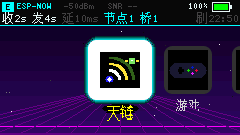
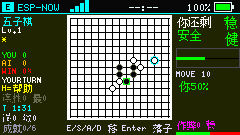
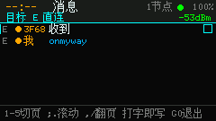

# AEGIS OS（玄甲）

AEGIS OS 是跑在 M5Stack Cardputer ADV 上的掌上系统：240×135 屏幕、没有 PSRAM，却把游戏、工具、LoRa 消息、AI 对话和外部小屏镜像装进了同一套界面。

它不是单个应用，也不是桌面移植。整机由三块板配合：Cardputer ADV 跑系统本体，管界面、键盘、应用和组网调度；两台 160×80 的 C3 桥把 ESP-NOW 转成 433MHz LoRa，并保持 Meshtastic 兼容；一台 320×240 的 C3 监视器拿状态帧在本机重绘画面。

所有应用都按 240×135、无 PSRAM 的约束写，按需装载、退出即卸载，用 RAM 换功能。

## 目录

- [这套系统做了什么](#这套系统做了什么)
- [界面预览](#界面预览)
- [硬件与组网](#硬件与组网)
- [应用](#应用)
- [天链与组网](#天链与组网)
- [编译与烧录](#编译与烧录)
- [版本](#版本)
- [仓库结构](#仓库结构)
- [已知限制](#已知限制)
- [更新日志](CHANGELOG.md)

## 这套系统做了什么

界面、输入、组网和外设都在同一层：前台跑着应用也能收远端消息，顺手就能改设置。

### 应用体系

- **游戏**：棋类（五子棋、将棋、黑白棋、四子棋、跳棋）、牌类（UNO、斗地主、21 点）、街机与休闲（赛车、扫雷、俄罗斯方块、贪吃蛇、打砖块、乒乓、Flappy、小蜜蜂、坦克、迷宫、打地鼠、2048、FPS）。五子棋带十级难度、作弊问责、战报和回放。
- **工具**：天链、DeepSeek 对话、科学/函数计算器、万用表、DHT11 温湿度、超声波测距、水位、继电器测试、麦克风电平、红外遥控、StringIR。
- **系统**：设置、时钟、IMU、系统信息、网络。

启动器把这三类收进三个文件夹，天链固定在第一屏第一位；应用按需装载、退出卸载。

### 状态栏与应用内消息

顶部系统栏常驻显示状态。`ui_notify` 在任何应用前台叠加提示条，不打断手头的事；全屏游戏换成内联单行，不压画面。收到天链消息后按 `=` 直接进回复页。

### 天链：LoRa 消息

天链（`app_zdmsg`）分消息列表、写消息、节点、设置、关于五页。文本从系统本体经 ESP-NOW 送到就近 C3，再由 C3 发进 LoRa，回程沿原路返回。`E`、`L`、`R` 三个标记分别代表 ESP-NOW 直连、LoRa 空口和经桥转发。

### 组网与镜像

系统本体自身没有 LoRa 模块，远距离全靠两台 C3 桥。ESP-NOW 通着就走 2.4GHz；断链约 3 秒后由就近桥转 LoRa；链路一恢复立刻回切，不等超时。

监视器同步的是 240B 的 GMKSTATE 状态帧，不是屏幕像素：它在本机重绘棋盘、光标、比分和文本，并把提示行并进自己的页面。LoRa 兜底时改发差分帧（实测 14–15B），动作类游戏不参与，免得低帧率被当成连续画面。

### Meshtastic 兼容

两台桥提供 Meshtastic 的 BLE GATT 服务、`want_config` 配置序列、Admin 读写和文本/ACK，官方 App 能通过 BLE 连上并改设置。验证方式是用一块 C3 跑「官方 App 等价客户端」走完整流程；手机端官方 App 还没在所有机型上复测。

### AI 对话与首次配置

DeepSeek 对话由设备直接发请求。2.1.1 起，首次打开且没有 Key 时自动开 `Cardputer-AI` 热点（密码 `12345678`），浏览器进 `http://192.168.4.1` 填写；页面只显示 Key 尾号，可清空可更换，退出后热点关闭并连回原来的 WiFi。已有 Key 就不再弹热点。Key 存 NVS，兜底 Key 只活在编译期。

### 设置与自测命令

设置应用收拢音量、静音、亮度、主题色、WiFi、天链、蓝牙、时区、NTP、电池、内存、关于和重置，改完即时生效并写 NVS。三块板都留了串口自测口：ADV 侧用 `ZDGO:<应用名>` 开应用、`ZDKEY:<键名>` 注入按键，并回 `ZDTRC` 轨迹；C3 侧输入 `t help` 查链路、镜像、页面和按键注入命令。

## 界面预览

三张图都从 Cardputer ADV 的实机帧缓冲导出，原始分辨率 240×135，没有调试覆盖层。

<table>
<tr>
<td></td>
<td></td>
<td></td>
</tr>
<tr>
<td>主页 / Launcher：系统栏常驻显示链路、节点和电量；天链固定在第一屏，右侧是游戏、工具、系统文件夹。</td>
<td>五子棋：15×15 棋盘、十级 AI；右侧显示剩余提示、步数和实时胜率，底部是战绩与成就。</td>
<td>天链：消息列表按 E/L/R 标记链路来源，收到和发出的消息都在这里；直接打字进入写消息页。</td>
</tr>
</table>

## 硬件与组网

### 系统本体（Cardputer ADV）

ESP32-S3、8MB Flash、无 PSRAM，跑完整系统、键盘输入、应用界面和组网调度；应用框架 Mooncake，UI 层 smooth_ui_toolkit + LovyanGFX。

仓库：本仓库（[cardputer-aegis-os](https://github.com/owqll45/cardputer-aegis-os)）。

### 两台 C3 桥（160×80）

两台 ESP32-C3，接 SX1268 做 ESP-NOW ↔ LoRa 转发，同时提供 Meshtastic 兼容的 BLE 接口。

### 一台监视器（320×240）

一台 ESP32-C3，接收 GMKSTATE 状态帧并在本机重绘画面；433 天线未确认，只收不发。

### 另外两部分

C3 桥和监视器各有独立公开仓库，与系统本体分开取用：

- 两台 C3 桥（160×80）：[aegis-c3-bridge](https://github.com/owqll45/aegis-c3-bridge)
- 监视器（320×240）：[aegis-monitor](https://github.com/owqll45/aegis-monitor)

三块板的分工：

| 设备 | 芯片 | 屏幕 | 射频 | 角色 |
|---|---|---|---|---|
| Cardputer ADV | ESP32-S3，8MB Flash，无 PSRAM | 240×135 | WiFi / BLE / ESP-NOW | 系统本体：UI、键盘、应用、组网调度 |
| C3 桥 ×2（3F:68、31:D0） | ESP32-C3，4MB Flash | ST7735S 160×80 | SX1268（E22-400M22S，433MHz）+ BLE | ESP-NOW ↔ LoRa 转发、Meshtastic 节点 |
| C3 监视器（AA:D0） | ESP32-C3，4MB Flash | ST7789 320×240 | SX1268（433MHz） | 镜像系统本体画面，**无天线只收** |

系统本体本身**没有 LoRa 模块**。远距离链路是「ADV 上的系统本体 ──ESP-NOW──> 就近 C3 桥 ──LoRa──> 远端」，桥同时兼容 Meshtastic 的文本包格式。

### 接线要点

两台 C3 桥（ST7735S + SX1268 共用 SPI2）：

| 信号 | GPIO |
|---|---|
| SPI SCK / MOSI / MISO | 10 / 7 / 6 |
| 屏幕 DC / CS | 0 / 1 |
| 屏幕 RES / BL | 接 3V3（常亮） |
| SX1268 NSS / RESET / BUSY / DIO1 | 8 / 5 / 4 / 3 |
| 按键（BOOT） | 9 |

监视器（ST7789 320×240 + SX1268）：

| 信号 | GPIO |
|---|---|
| SPI SCK / MOSI / MISO | 10 / 7 / 6 |
| 屏幕 CS / DC / BL | 1 / 0 / 13 |
| 按键 | 9 |

屏幕和 LoRa 共总线，固件里必须保证 LCD 的 CS 窗口内不被 LoRa 事务插入，否则会花屏——这是一个实际踩过的问题，`d3/c3msg/main/lora.c` 的文件头有记录。

## 应用

启动器按「游戏 / 工具 / 系统」分成三个文件夹，天链永远在首页第一位。应用注册表在 [awa/main/main.cpp](awa/main/main.cpp)，按需实例化，关闭即卸载。

### 游戏

五子棋、将棋、黑白棋、四子棋、跳棋、UNO、斗地主、21 点、赛车、扫雷、俄罗斯方块、贪吃蛇、打砖块、乒乓、Flappy、小蜜蜂、坦克、迷宫、打地鼠、2048、FPS。

其中五子棋功能最齐：

- 十级难度（Lv.1–Lv.10），选难度直接开新局；
- 作弊模式（单人 AI 局可用，Y 键开关，1/2/3 选不同作弊方式）；
- 作弊问责：被抓先冻结约 1.5 秒，再弹选择题，「承认 / 嘴硬」走不同台词；
- 战报：局终 2.2 秒后弹结果面板，输/平停在战报，不自动开下一局；
- 回放：V 键开始/停止，每 350 ms 摆一手，结束后恢复原棋盘；
- 智力测试模式：开启后所有作弊键失效。

斗地主、21 点是 2.1.0 加入的完整牌局，赛车用 IMU 倾斜控制。

### 工具

天链（LoRa 消息终端）、DeepSeek 对话、科学计算器、函数计算器、万用表、DHT11 温湿度、超声波测距、水位、继电器测试、麦克风电平、红外遥控、StringIR 字符串红外工具。

### 系统

设置、时钟、IMU、系统信息、网络。

### DeepSeek 对话

2.1.1 起，首次打开且没有 Key 时自动开 `Cardputer-AI` 热点（密码 `12345678`），浏览器进 `http://192.168.4.1` 填 Key。配置页只显示 Key 尾号，可清空可更换；退出后热点关闭、自动连回原 WiFi。已有 Key 不会弹热点。Key 存 NVS，兜底 Key 只在编译期存在，任何页面都不回显。

## 天链与组网

天链（`app_zdmsg`）是消息终端，页面有消息列表、写消息、节点、设置、关于。它和 C3 之间走 ZD v1 协议（24B 头 + ≤226B payload + CRC16，ESP-NOW channel 1 广播），C3 再按需把文本送进 LoRa。

几个实际行为：

- **任意应用内收消息**：`ui_notify` 在顶部系统栏叠加提示条，不打断当前应用；按 `=` 直接跳天链面板回复。全屏游戏用内联单行提示，不覆盖游戏画面。
- **三条路径可区分**：`E` = ESP-NOW 直连，`L` = LoRa 空口，`R` = 经 C3 桥转发。
- **近距优先、断链兜底、恢复回切**：ESP-NOW 可用走 2.4GHz；断链超过约 3 秒由就近 C3 用 LoRa 转发或镜像；主链路恢复立刻回切，不等超时。
- **监视器镜像**：C3 监视器同步 GMKSTATE 全量状态帧（240B），不是屏幕像素。ESP-NOW 断掉后，桥把同一份状态用 LoRa 私有 port `0x0102` 重发；差分帧实测 payload 只有 14–15B。动作类应用（打砖块、Flappy、小蜜蜂、赛车、FPS）明确不参与 LoRa 兜底，避免用低帧率冒充连续画面。
- **Meshtastic 兼容**：C3 桥实现 Meshtastic 的 BLE GATT 服务、`want_config` 配置序列、Admin 读写和文本/ACK，官方 App 可通过 BLE 连接并改设置。验证用一块 C3 跑「官方 App 等价客户端」，完整走完配对 → 读 37 条配置 → Admin 写入并读回 → 发文本收 ACK → 重启后 NVS 保留，全部 PASS；手机端官方 App 的实机流程没有在所有机型上复测。
- **时间同步**：LoRa 私有 port `0x0101` 广播 UTC，系统本体和 C3 都能采用。

## 编译与烧录

需要 ESP-IDF 5.5.x。系统本体工程是 ESP32-S3，两个 C3 工程 target 是 ESP32-C3。

```powershell
# 系统本体：Cardputer ADV
idf.py -C awa build
idf.py -C awa -p COM9 -b 460800 flash monitor

# C3 桥：160×80 小屏 + LoRa
idf.py -C d3/c3msg build
idf.py -C d3/c3msg -p COM3 -b 460800 flash monitor

# C3 监视器：320×240
idf.py -C gomoku_c3 build
idf.py -C gomoku_c3 -p COM3 -b 460800 flash monitor
```

串口按实际枚举调整：本机 ADV 在 `COM9`，C3 在 `COM3`，烧录波特率 `460800`。C3 的日志走 USB-Serial/JTAG，不依赖波特率。首次给 C3 工程构建时如提示 target 不匹配，先执行一次 `idf.py -C <工程目录> set-target esp32c3`。

### 一键刷写包（Windows）

不想装 ESP-IDF 时，直接下载 [2.1.1 一键刷写包](https://github.com/owqll45/cardputer-aegis-os/releases/tag/2.1.1)：解压后双击 `flash_aegis.bat`，脚本自动列出串口、默认 460800、写完自动校验；刷写覆盖 Flash 固件区（含 NVS），设置会被清空，固件未内置 API Key。详细步骤和失败救援见包内 `FLASHING.md`。

### DeepSeek Key

仓库不包含 `awa/main/apps/app_ai/app_ai_secrets.h`（已在 `.gitignore` 中）。想在编译期内置兜底 Key 就自己建：

```c
#pragma once
#define AI_DEEPSEEK_KEY ""
#define AI_MIMO_KEY ""
```

不建也能编译，运行时用首次配置页填写。

## 版本

- **v2.1.0** — [tag 2.1.0](https://github.com/owqll45/cardputer-aegis-os/tree/2.1.0)：斗地主、21 点等游戏落地，四款游戏实测修复，API Key 外置到 secrets 头文件。
- **v2.1.1** — [tag 2.1.1](https://github.com/owqll45/cardputer-aegis-os/tree/2.1.1)：DeepSeek 首次使用 SoftAP 配置 API Key，配置页支持尾号显示、清空、更换；修复配置模式退出后的 WiFi 重连。

当前 `master` 即 2.1.1。完整变更记录见 [CHANGELOG.md](CHANGELOG.md)。

## 仓库结构

```
awa/                系统本体固件（ESP32-S3，Mooncake）
  main/apps/        应用：游戏、工具、系统
  main/apps/utils/  glink（ESP-NOW 镜像）、zdlink（ZD 消息）、ui_notify（全局通知）
  main/hal/         显示、网络、存储、AI
d3/c3msg/           C3 桥固件（160×80，Meshtastic 兼容 LoRa）
gomoku_c3/          C3 监视器固件（320×240，状态镜像）
d3/*.md             ZD 协议说明、BLE 接入方案、硬件实测报告
```

C3 桥与监视器已拆到独立公开仓库，主仓库仍保留源码目录和现有构建路径；两块板可以单独取用，链接见「硬件与组网」。

## 已知限制

- **没有 PSRAM**：整屏 240×135 的 8bpp 画布就可能拿不到连续块，很多应用改用局部缓冲和直接绘制；应用必须按需装载、退出卸载。
- **监视器 AA:D0 只收不发**：该 C3 的 433 天线状态未确认，固件把它列入 `NO_ANTENNA_MAC`，LoRa 发射恒关，PA 设 −9dBm，也不发 NodeInfo，镜像兜底只能由桥侧发起。
- **LoRa 没有长距离拉距数据**：只做了室内/同层的收发、延迟和带宽实测（全量镜像块最坏等待约 2.0 秒）。433MHz、22dBm 的理论视距不能当成这个项目的实测距离，城市环境按短距预期。
- **动作类游戏不镜像**：LoRa 兜底只覆盖低频状态类应用，打砖块、Flappy、小蜜蜂、赛车、FPS 会明确提示「链路不支持镜像」。
- **Meshtastic 手机端**：BLE 协议层和等价客户端验证通过，官方 App 的完整人工流程尚未在所有手机型号上复测。
- **截图**：开发期的 `shots/` 仍被忽略；仓库只收录「界面预览」里的三张实机帧缓冲导出图，放在 `docs/screenshots/`。
